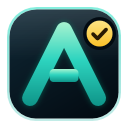
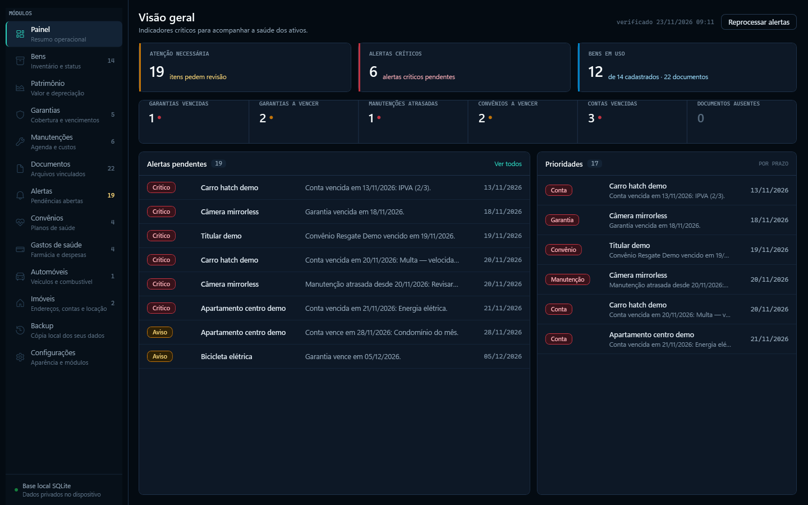
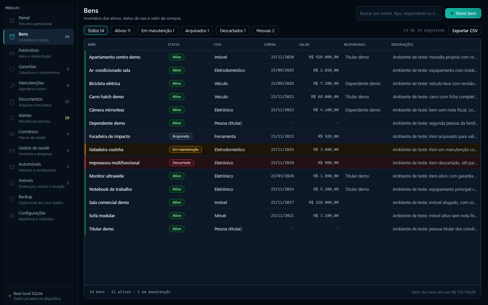
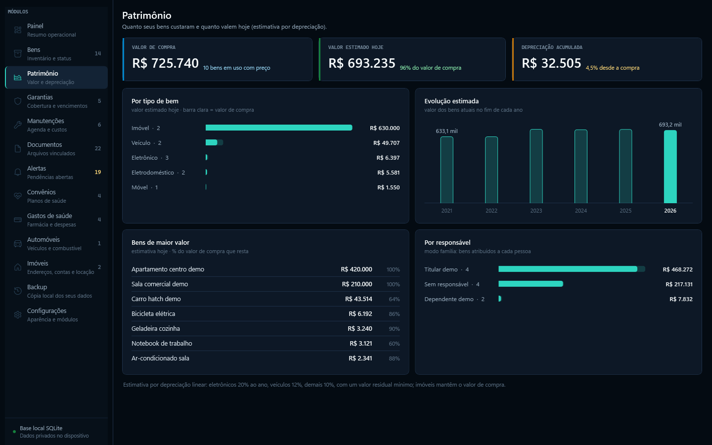
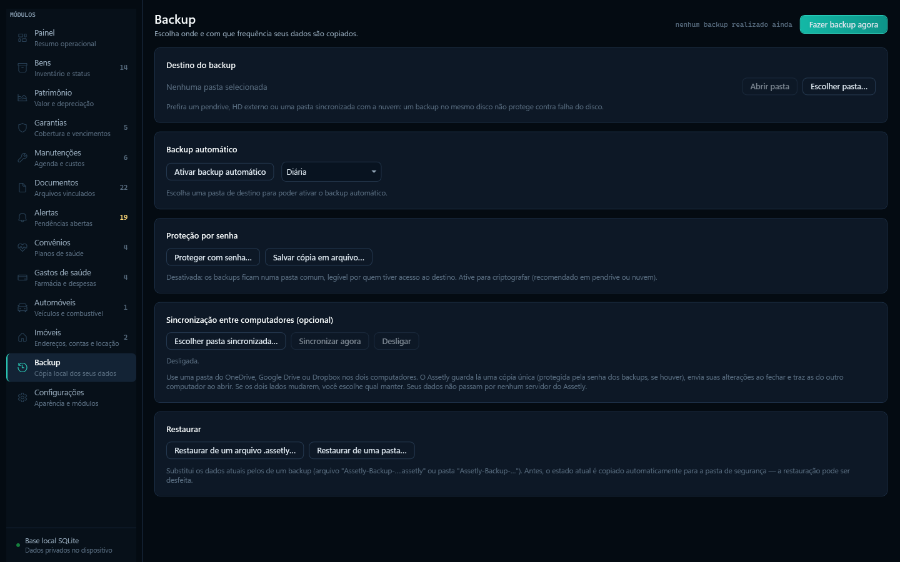

<p align="center">
  
</p>

<h1 align="center">Assetly</h1>

<p align="center">
  Seus bens, garantias, notas fiscais, carros, imóveis e patrimônio — organizados no seu computador, sem conta e sem nuvem.
</p>

<p align="center">
  <a href="https://github.com/dcCarreto/Assetly/releases/latest"></a>
  <a href="https://github.com/dcCarreto/Assetly/actions/workflows/ci.yml"></a>
  
  <a href="LICENSE"></a>
</p>

<p align="center">
  <a href="https://github.com/dcCarreto/Assetly/releases/latest"><b>⬇ Baixar o instalador para Windows</b></a>
</p>



Assetly é um aplicativo de área de trabalho para organizar bens pessoais, garantias, documentos e notas fiscais, manutenções, convênios e gastos de saúde, automóveis, imóveis, patrimônio e alertas em um banco local. Ele foi pensado para quem quer manter o controle dos próprios itens importantes sem depender de conta online, assinatura, nuvem ou telemetria.

O programa já pode ser usado no dia a dia: há instalador para Windows, e a cópia instalada se atualiza sozinha quando uma versão nova é publicada (veja [Instalar](#instalar-recomendado)). O Assetly não usa número de versão: cada versão é identificada pela **data** em que foi publicada (por exemplo, `2026.11.23`).

## Visão Geral

Com o Assetly, você pode registrar itens como notebook, eletrodomésticos, ferramentas, bicicleta, móveis e outros bens. Para cada bem, é possível acompanhar garantias, anexar documentos, registrar manutenções, controlar convênios e gastos de saúde e receber alertas sobre prazos importantes.

O foco do projeto é simples:

- manter seus dados no seu computador;
- organizar documentos e prazos em um só lugar;
- avisar sobre garantias e convênios vencendo ou vencidos, manutenções próximas ou atrasadas e ausência de nota fiscal;
- proteger os dados com backup (opcionalmente criptografado) e restauração locais;
- mostrar quanto o seu patrimônio vale hoje;
- oferecer um ambiente de teste completo para experimentar o aplicativo sem misturar dados fictícios com dados reais.

## O Que Já Funciona

- Cadastro, edição, exclusão, listagem e mudança de status de bens (arquivar, desarquivar, descartar), com **marca, modelo, número de série, loja e localização** — o que o seguro, o boletim de ocorrência e a garantia pedem.
- **Lixeira**: bem excluído (com garantias, manutenções, documentos e arquivos, fichas e contas) pode ser restaurado por 30 dias.
- **Importação**: planilha CSV de bens (cadastro em massa) e de volta o JSON exportado pelo próprio Assetly.
- **Busca em tudo** (`Ctrl+K`): acha qualquer registro em todos os módulos e leva direto a ele.
- Registro de garantias com período, tipo, fornecedor e contato de suporte.
- Registro de manutenções preventivas, corretivas, inspeções e limpezas, com conclusão, custo e cancelamento.
- Cadastro de documentos vinculados aos bens, com cópia do arquivo para uma pasta local privada.
- Notas fiscais eletrônicas: leitura do **QR Code da NFC-e** e do texto da nota por **OCR do Windows** (sem internet) a partir de uma foto ou imagem escaneada; chave de acesso validada, link de consulta e `Consultar nota` na Sefaz. No cadastro do bem, `Preencher pela nota (foto)…` preenche data e valor e anexa a imagem como nota fiscal.
- Controle de convênios de saúde (plano, ortodontia, farmácia, emergência), com vigência e cancelamento.
- Registro de gastos de saúde (farmácia, consultas, exames, procedimentos), com totais do ano, prestador e CPF/CNPJ.
- **Relatório para o Imposto de Renda**: gastos de saúde dedutíveis por prestador e paciente e a lista de "Bens e Direitos" com o valor de aquisição.
- **Comprovantes** anexados a manutenções, contas e abastecimentos.
- Automóveis: ficha completa do veículo (placa, RENAVAM, chassi, licenciamento, seguro, revisões), abastecimentos com consumo km/l e custo por km, e despesas (IPVA, multas, seguro...) com vencimento e parcelas.
- Imóveis: ficha completa (endereço, área, matrícula, IPTU, condomínio, seguro, locação) e contas (IPTU, condomínio, água, energia...) com vencimento.
- **Contas recorrentes**: condomínio, energia, internet... geram a do mês seguinte quando são pagas (parcelas finitas, como IPVA e financiamento, continuam sendo criadas de uma vez).
- Alertas automáticos que **se resolvem sozinhos** quando a pendência é corrigida (garantia renovada, manutenção concluída, nota fiscal anexada...).
- Painel com indicadores, alertas pendentes, prioridades clicáveis e **lembrete de backup** (nunca feito, antigo ou falhando).
- **Notificações do Windows** com o Assetly na bandeja, aberto junto com o Windows (opcional).
- **PIN de abertura** opcional.
- **Patrimônio**: valor de compra x valor estimado hoje (depreciação linear por tipo de bem, taxa própria por bem ou **valor atual informado** — avaliação, tabela FIPE), **patrimônio líquido** descontando financiamentos em aberto, distribuição por tipo e por responsável, evolução ano a ano e bens de maior valor.
- **Modo família**: cada bem pode ter um responsável (uma pessoa cadastrada), com coluna, busca e totais por pessoa no Patrimônio.
- Backup manual e automático (diário, semanal ou mensal), **protegido por senha** (AES-256, arquivo único `.assetly`) se você quiser, **teste do backup sem restaurar** e restauração com cópia de segurança do estado anterior.
- **Sincronização opcional entre computadores** por uma pasta do OneDrive, Google Drive ou Dropbox — sem servidor do Assetly, com escolha de qual versão manter quando os dois lados mudam.
- **Exportação**: qualquer tabela para CSV (abre direto no Excel) e todos os dados para JSON (que também pode ser importado de volta).
- Tabelas com busca, filtros, ordenação por coluna e atalhos de teclado.
- Tema escuro ou claro, quatro cores de destaque, densidade das tabelas e módulos reordenáveis/ocultáveis.
- Valores em formato brasileiro (`1.234,56`) e totais separados por moeda.
- Registro local de erros para diagnóstico, sem envio para lugar nenhum.
- Ambiente de produção local e ambiente de teste isolado com dados fictícios e anexos reais.
- Instalador para Windows (Inno Setup) com atualização automática verificada por SHA-256 assinado (só instala o que foi publicado com a chave do projeto).

### Telas

| Bens | Patrimônio |
| --- | --- |
|  |  |

| Backup e sincronização |
| --- |
|  |

As imagens mostram o ambiente de teste, com dados fictícios.

## Instalar (recomendado)

1. Acesse as [Releases do Assetly](https://github.com/dcCarreto/Assetly/releases) e baixe `Assetly-Setup-AAAA.MM.DD.exe` da versão mais recente (o nome traz a data da versão).
2. Execute o arquivo. A instalação é por usuário (em `%LOCALAPPDATA%\Programs\Assetly`), não pede senha de administrador nem exige o .NET, e cria atalhos no menu Iniciar — inclusive um para o ambiente de teste — e, se você quiser, na área de trabalho.
3. Na primeira vez, o Windows pode mostrar "O Windows protegeu o computador" (SmartScreen), porque o instalador ainda não tem assinatura digital paga. Clique em **Mais informações → Executar assim mesmo**.

**Atualizações automáticas:** o Assetly instalado procura versão nova ao abrir e a cada 6 horas, baixa o instalador em segundo plano, confere o SHA-256 publicado e a assinatura dele com a chave do projeto embutida no programa (um download alterado, ou uma versão publicada sem essa chave, é descartado) e mostra o botão **Atualizar para 23/11/2026** (a data da versão) na barra de título. Clique para fechar, atualizar e reabrir em poucos segundos — ou simplesmente continue usando: a versão nova é instalada quando você fechar o programa. Em `Configurações > Versão e atualizações` você vê a versão instalada, pode procurar manualmente e desligar a atualização automática.

**Seus dados ficam a salvo:** eles moram em `~/.assetly`, fora da pasta do programa. Atualizar ou desinstalar (Configurações do Windows > Aplicativos > Assetly) nunca apaga os dados. Antes de uma versão nova mudar a estrutura do banco, uma cópia automática é guardada em `~/.assetly/seguranca/`; e uma versão antiga do programa se recusa a abrir dados gravados por uma mais nova, em vez de corrompê-los.

Prefere não instalar? Gere o executável único a partir do código-fonte (veja [Gerar o Executável](#gerar-o-executável)) — ele funciona igual, mas não se atualiza sozinho.

## Baixar o Código-fonte

Para quem quer compilar ou contribuir. Para só usar o programa, prefira o [instalador](#instalar-recomendado).

Há duas formas práticas de baixar o código.

### Opção 1: baixar com Git

Use esta opção se você já tem Git instalado e quer manter o projeto fácil de atualizar.

```powershell
cd $HOME\source\repos
git clone https://github.com/dcCarreto/Assetly.git
cd Assetly
```

Depois, quando quiser atualizar o código:

```powershell
git pull
```

### Opção 2: baixar como ZIP

Use esta opção se você não quer usar Git.

1. Acesse `https://github.com/dcCarreto/Assetly`.
2. Clique em `Code`.
3. Clique em `Download ZIP`.
4. Extraia o arquivo ZIP em uma pasta de sua preferência.
5. Abra o PowerShell dentro da pasta extraída.

Se baixar por ZIP, o projeto funciona normalmente, mas você não terá o fluxo simples de atualização por `git pull`.

## Requisitos

Para **usar** o executável gerado (`Assetly.exe`), basta Windows 10 ou 11 de 64 bits — não é preciso instalar o .NET.

Para **compilar** a partir do código-fonte (ou gerar o executável), você precisa de:

- Windows com PowerShell;
- .NET SDK 10 ou superior;
- conexão com a internet na primeira compilação para baixar dependências do NuGet.

### Verificar o .NET

Abra o PowerShell e rode:

```powershell
dotnet --version
```

O resultado deve indicar 10.0 ou superior. Se o comando não existir ou mostrar uma versão antiga, instale o [.NET SDK](https://dotnet.microsoft.com/download) atual antes de executar o programa.

## Primeira Execução

### Pela Visual Studio

Abra `Assetly.slnx` na Visual Studio. O projeto `Assetly.Apresentacao` é o único executável da solução e já é reconhecido como projeto de inicialização automaticamente. Escolha o perfil desejado no dropdown ao lado do botão Run — **Assetly (Produção)** ou **Assetly (Teste)** — e pressione `F5`.

### Pela linha de comando

Na raiz do projeto:

```powershell
dotnet run --project src\Assetly.Apresentacao
```

Para abrir direto no ambiente de teste:

```powershell
dotnet run --project src\Assetly.Apresentacao -- --teste
```

Na primeira execução, o aplicativo compila o projeto, baixa dependências do NuGet se necessário, cria o banco SQLite local e abre a janela principal.

### Gerar o Executável

Para ter um único `Assetly.exe` que pode ser copiado para qualquer pasta (ou outro computador) e aberto com duplo clique, sem instalar o .NET:

```powershell
dotnet publish src\Assetly.Apresentacao -p:PublishProfile=win-x64
```

O arquivo é gerado em `publicar\Assetly.exe` (cerca de 70 MB, pois já inclui o .NET). Compilações locais aparecem como versão "desenvolvimento" e não procuram atualizações. Para abri-lo no ambiente de teste, crie um atalho com o argumento `--teste`. Os dados continuam em `~/.assetly`, independentemente de onde o executável estiver.

O Assetly abre uma única janela por ambiente: se você tentar abrir de novo, ele avisa que já está aberto. Produção e teste podem ficar abertos ao mesmo tempo.

## Escolher Produção ou Teste

O Assetly possui dois ambientes separados.

### Produção

Use produção para seus dados reais.

- Banco: `~/.assetly/banco/assetly.sqlite3`
- Documentos copiados: `~/.assetly/documentos/`

### Teste

Use teste para experimentar o sistema sem risco.

- Banco: `~/.assetly-teste/banco/assetly-teste.sqlite3`
- Documentos gerados ou copiados: `~/.assetly-teste/documentos/`

O ambiente de teste cria uma base demonstrativa com bens, garantias, manutenções, alertas e arquivos anexados. Esses arquivos são documentos físicos reais, gerados localmente, e aparecem no módulo `Documentos`.

### Alternar Ambiente

Pela Visual Studio, use o dropdown de perfis de execução (**Assetly (Produção)** / **Assetly (Teste)**) ao lado do botão Run.

Pela linha de comando, use o argumento `--teste`:

```powershell
dotnet run --project src\Assetly.Apresentacao -- --teste
```

Ou defina a variável de ambiente antes de rodar:

```powershell
$env:ASSETLY_AMBIENTE = 'teste'
dotnet run --project src\Assetly.Apresentacao
```

Para voltar ao ambiente de produção no mesmo terminal:

```powershell
Remove-Item Env:ASSETLY_AMBIENTE
```

## Como Usar o Assetly

Esta seção descreve o fluxo de uso mais comum. Para experimentar sem medo, comece pelo ambiente de teste. Quando estiver confortável, alterne para produção e registre seus dados reais.

### 1. Acompanhar o Painel

Ao abrir o aplicativo, a primeira tela é o painel. Ele mostra:

- quantos itens pedem atenção (alertas pendentes e documentos ausentes);
- quantos alertas críticos estão pendentes;
- quantos bens estão em uso;
- garantias vencidas e a vencer, manutenções atrasadas, convênios a vencer, documentos ausentes e alertas pendentes;
- lista de alertas pendentes, do mais grave para o menos grave;
- lista de prioridades por prazo.

Os números consideram apenas bens em uso (ativos ou em manutenção): uma garantia vencida de um item descartado não é pendência.

Clique em uma linha de alerta ou de prioridade para ir direto ao módulo onde ela é resolvida. Os dados se atualizam na hora depois de qualquer alteração, e a tela aberta é redesenhada sozinha a cada 30 segundos (por padrão; ajuste em `Configurações`); os alertas são refeitos também na virada do dia. O botão `Reprocessar alertas` força uma verificação imediata.

### 2. Registrar um Bem

Entre no módulo `Bens` e clique em `Novo bem` (ou `Ctrl+N`).

Preencha:

- nome do bem;
- tipo;
- marca, modelo, número de série e localização (cômodo, endereço, garagem) — opcionais, mas são o que o seguro e o boletim de ocorrência pedem;
- data de compra, loja e preço de compra, se quiser acompanhar (aceita `1234,56`, `1.234,56` ou `R$ 1.234,56`);
- valor atual informado (avaliação, tabela FIPE, imóvel valorizado) e a data da avaliação, se quiser substituir a estimativa por depreciação a partir dessa data;
- depreciação própria em % ao ano, se a padrão do tipo não servir para este bem;
- observações.

Data e preço são independentes: dá para informar só um deles. Em `Responsável (modo família)` escolha a pessoa da casa a quem o bem pertence (cadastre as pessoas como bens do tipo **Pessoa (titular)**); o filtro `Pessoas` lista só elas.

Tem a nota fiscal em papel ou a foto dela? Clique em `Preencher pela nota (foto)…` e escolha a imagem: o Assetly lê o QR Code da NFC-e e o texto impresso (OCR do próprio Windows, sem enviar a imagem a lugar nenhum), preenche a data e o valor que encontrar e, ao salvar, anexa a imagem ao bem como nota fiscal. Sempre confira os campos — o OCR pode errar em fotos tremidas ou cupons apagados. Para convênios e gastos de saúde, cadastre a pessoa titular com o tipo **Pessoa (titular)** — esse tipo não gera o alerta de nota fiscal ausente.

Depois de salvo, o bem aparece na tabela. Selecione uma linha (ou clique com o botão direito) para usar as ações:

- `Detalhes`, `Editar`;
- `Ativar` (também desarquiva um bem arquivado) e `Manutenção`;
- `Arquivar`: tira o bem de uso e para de gerar alertas, mas pode ser desfeito;
- `Descartar`: marca o bem como descartado de forma definitiva, mantendo o histórico;
- `Excluir`: tira o bem e tudo o que está ligado a ele (garantias, manutenções, documentos e as cópias dos arquivos, convênios, gastos, fichas, contas e alertas). A confirmação mostra quantos registros vão junto. Tudo vai para a `Lixeira` (botão no topo da tela): por 30 dias dá para `Restaurar` o bem inteiro ou `Excluir de vez`; depois disso ele é apagado sozinho.

Tem uma planilha com seus bens? `Importar planilha…` cadastra todos de uma vez a partir de um CSV com uma linha de títulos — só a coluna `Nome` é obrigatória; `Tipo`, `Status`, `Data de compra`, `Preço`, `Moeda`, `Marca`, `Modelo`, `Número de série`, `Loja`, `Localização`, `Valor atual`, `Responsável` e `Observações` são reconhecidas pelo nome (o CSV exportado pela própria tabela de Bens também serve). Se alguma linha tiver erro, nada é importado e a lista de problemas aparece; linhas iguais a bens já cadastrados são puladas.

### 3. Registrar Garantias

Entre em `Garantias` e clique em `Nova garantia`.

Informe:

- bem relacionado;
- tipo de garantia;
- fornecedor e contato de suporte;
- data inicial;
- data final.

O Assetly usa essas datas para indicar garantias ativas, próximas do vencimento ou vencidas. Alertas são gerados automaticamente quando uma garantia vence em até 30 dias ou já venceu. Se você renovar a garantia (editar a data final) ou registrar uma garantia estendida que continue a cobertura, o alerta é resolvido sozinho. Garantia vencida gera um aviso (não um alerta crítico): o bem continua funcionando, só ficou sem cobertura.

### 4. Registrar Manutenções

Entre em `Manutenções` e clique em `Nova manutenção`.

Informe:

- bem relacionado;
- tipo de manutenção;
- descrição;
- data agendada.

Você pode usar esse módulo para revisões, inspeções, limpezas, trocas de peças e assistências técnicas. Quando a manutenção for feita, use `Concluir` informando a data e o custo, se houver. `Cancelar` encerra a manutenção mantendo o registro; `Excluir` apaga o registro.

Manutenções atrasadas aparecem como prioridade no painel, e manutenções nos próximos 7 dias geram um alerta informativo.

### 5. Anexar Documentos

Entre em `Documentos` e clique em `Novo documento`.

Informe:

- bem relacionado;
- tipo do documento;
- arquivo (botão `Selecionar…` abre o seletor de arquivos do Windows);
- nome do documento (preenchido a partir do nome do arquivo, se você deixar em branco);
- data de registro.

Ao salvar, o Assetly copia o arquivo para a pasta local do ambiente atual. Isso evita que o cadastro dependa do local original do arquivo, como `Downloads`, `Área de Trabalho` ou um pendrive.

No ambiente de produção, os documentos vão para:

```text
~/.assetly/documentos/
```

No ambiente de teste, os documentos vão para:

```text
~/.assetly-teste/documentos/
```

Para notas fiscais eletrônicas (NF-e e NFC-e), informe a `Chave de acesso` (44 dígitos, validada pelo dígito verificador) ou clique em `Ler QR Code / OCR da imagem` para preencher chave, link de consulta e data a partir de uma foto da nota. A coluna `Nota eletrônica` mostra o modelo e o número, e `Consultar nota` abre a consulta oficial na Sefaz (pelo link do QR Code ou, sem ele, pelo portal nacional com a chave já copiada).

Clique no nome do arquivo (ou dê duplo clique na linha) para abri-lo; `Mostrar na pasta` abre o Explorador já com o arquivo selecionado. Ao editar um documento, só escolha outro arquivo se quiser substituí-lo — renomear ou mudar o tipo não exige o arquivo. Excluir um documento apaga também a cópia guardada pelo Assetly (o arquivo original nunca é tocado).

### 6. Usar Alertas

Entre em `Alertas` para ver as pendências.

O Assetly gera alertas automáticos para:

- garantia vencendo (até 30 dias) e garantia vencida — a não ser que outra garantia do mesmo bem (estendida, por exemplo) continue a cobertura;
- licenciamento e seguro de veículo, seguro de imóvel e contrato de aluguel vencendo ou vencidos;
- revisão do veículo próxima ou atrasada (por km ou data);
- contas de veículos e imóveis a vencer ou vencidas;
- manutenção próxima (até 7 dias) e manutenção atrasada;
- convênio vencendo (até 30 dias) e convênio vencido;
- ausência de nota fiscal para bens ativos ou em manutenção.

Alertas automáticos **se resolvem sozinhos** quando a pendência deixa de existir: garantia renovada, manutenção concluída ou cancelada, nota fiscal anexada, bem arquivado ou descartado. Você também pode marcar um alerta como `Ciente` ou `Resolver` manualmente, e `Reabrir` um alerta resolvido por engano. Alertas criados manualmente (`Novo alerta`) nunca são alterados pelo sistema.

### 7. Controlar Convênios de Saúde

Entre em `Convênios` e clique em `Novo convênio`.

Informe:

- titular (um bem do tipo Pessoa);
- tipo (convênio, ortodontia, farmácia, emergência);
- fornecedor e contato;
- data inicial e final de vigência.

O Assetly indica convênios ativos, próximos do vencimento, vencidos ou cancelados, e gera alertas para os que estão vencendo ou venceram. Um convênio cancelado é um estado definitivo e não pode mais ser editado (pode ser excluído).

### 8. Registrar Gastos de Saúde

Entre em `Gastos de saúde` e clique em `Novo gasto`.

Informe:

- titular;
- tipo (farmácia, consulta, exame, procedimento);
- descrição, data e valor.

Use esse módulo para acompanhar despesas avulsas de farmácia, consultas e exames, independentemente de estarem cobertas por um convênio. O rodapé mostra o total do ano atual e o total geral; o filtro `Este ano` ajuda a separar as despesas para a declaração de imposto de renda.

### 9. Controlar Automóveis

Entre em `Automóveis`. O módulo tem três abas:

- **Veículos** — clique em `Novo veículo` e preencha a ficha: marca, modelo, anos de fabricação e modelo, cor, combustível, placa (padrão antigo `ABC-1234` ou Mercosul `ABC1D23`), quilometragem, RENAVAM, chassi, vencimento do licenciamento, próxima revisão (por km e/ou por data) e seguro (seguradora, apólice e vencimento). O bem é criado junto (com data e valor de compra), ou você pode vincular a ficha a um bem do tipo Veículo já cadastrado. A coluna `Situação` mostra **Em dia**, **Atenção** (algo vence em breve) ou **Pendência** (algo venceu). `Ficha` reúne tudo: consumo médio, gasto com combustível nos últimos 12 meses, custo de combustível por km, despesas pagas e em aberto, manutenções e dados de compra.
- **Abastecimentos** — data, hodômetro, litros (ou kWh), valor, combustível, posto e se completou o tanque. O consumo (km/l) é calculado pelo método tanque cheio a tanque cheio, e a quilometragem do veículo é atualizada sozinha quando o hodômetro informado é maior.
- **Despesas** — IPVA, licenciamento, seguro, multas, pedágio, estacionamento, lavagem, financiamento... com vencimento, valor e pagamento. `Parcelas (meses)` cria parcelas mensais de uma vez (ex.: IPVA em 3 vezes); `Conta mensal sem fim` gera a do mês seguinte a cada pagamento. Use `Pagar` / `Desfazer pagamento`. `Anexar comprovante` guarda o recibo ou a nota junto da despesa (e no módulo Documentos); `Ver comprovante` abre. Abastecimentos e manutenções têm as mesmas duas ações, e o 📎 na linha mostra quem já tem comprovante.

Alertas automáticos: licenciamento e seguro vencendo (30 dias) ou vencidos, revisão próxima (faltando 1.000 km ou 15 dias) ou atrasada, e contas a vencer (7 dias) ou vencidas.

### 10. Controlar Imóveis

Entre em `Imóveis`. Duas abas:

- **Imóveis** — tipo (casa, apartamento, terreno, sala comercial...), situação (moradia própria, alugado, desocupado, veraneio...), endereço completo com CEP, área, quartos, banheiros, vagas, matrícula no cartório, inscrição do IPTU, condomínio mensal, seguro residencial e, se alugado, inquilino, valor do aluguel e fim do contrato. O rodapé soma a renda de aluguel e os condomínios.
- **Contas** — IPTU, condomínio, água, energia, gás, internet, seguro, aluguel, reforma, financiamento..., com vencimento, pagamento, parcelas ou recorrência mensal e comprovantes.

Alertas automáticos: seguro do imóvel vencendo ou vencido, contrato de aluguel terminando (60 dias) ou terminado, e contas a vencer ou vencidas. Imóveis não geram o alerta de nota fiscal ausente (o documento é a escritura — há tipos de documento `Escritura`, `Contrato`, `Documento do veículo (CRLV)` e `Apólice de seguro`).

### 11. Fazer Backup e Restaurar

Entre em `Backup`.

1. Clique em `Escolher pasta…` e selecione onde guardar as cópias — de preferência um pendrive, HD externo ou uma pasta sincronizada com a nuvem. O Assetly não aceita uma pasta dentro da sua própria pasta de dados.
2. Clique em `Fazer backup agora`. Uma pasta `Assetly-Backup-AAAA-MM-DD_HHMMSS` é criada com o banco e os documentos — ou, com senha ativada, um único arquivo `Assetly-Backup-….assetly` criptografado.
3. Opcional: ative o backup automático (diário, semanal ou mensal). Ele roda enquanto o Assetly estiver aberto, em segundo plano (a janela continua respondendo); se falhar (pendrive desconectado, por exemplo), o motivo aparece no card e uma nova tentativa é feita no ciclo seguinte. Se você fechar o programa no meio de um backup, ele termina antes de fechar.
4. Em `Manter no destino`, escolha quantos backups guardar (5, 10, 20, 30 ou todos). Depois de cada backup bem-sucedido, os mais antigos são apagados do destino — assim o pendrive não enche e o backup automático não para de funcionar. Instalações novas começam com 10; quem já usava o Assetly continua com "todos" até mudar.

Backup, restauração e sincronização rodam fora da tela: enquanto você espera, um painel mostra o que está sendo feito e a janela continua respondendo.

**Proteção por senha (recomendada para pendrive ou nuvem):** em `Proteção por senha`, clique em `Proteger com senha…`. A partir daí todo backup (manual, automático, `Salvar cópia em arquivo…` e a sincronização) é gravado num arquivo `.assetly` criptografado com AES-256 (chave derivada da senha com PBKDF2, 600 mil iterações). A senha fica guardada neste computador protegida pelo Windows (só a sua conta consegue lê-la) para os backups automáticos funcionarem. **Sem a senha não há como restaurar** — guarde-a num lugar seguro.

**Sincronização entre computadores (opcional):** em `Sincronização entre computadores`, escolha uma pasta do OneDrive, Google Drive ou Dropbox que exista nos dois computadores. O Assetly guarda lá uma cópia única (criptografada, se houver senha — use a mesma senha nos dois), traz as alterações do outro computador ao abrir e envia as suas ao fechar (e a cada 10 minutos durante o uso). Durante o uso e ao fechar ele só envia: seus dados nunca são substituídos com o programa aberto — uma mudança feita no outro computador chega na próxima abertura ou em `Sincronizar agora`. Se os dois lados mudaram, ele pergunta qual versão manter; a outra nunca é perdida (vai para a pasta de segurança). Um computador novo, ainda sem cadastros, simplesmente recebe os dados.

**Trocar a senha:** com a proteção ligada, `Trocar senha…` muda a senha num passo só. Os backups já feitos continuam abrindo só com a senha antiga, e o outro computador da sincronização precisa receber a mesma senha nova (senão aparece "senha incorreta").

**Testar um backup:** `Testar um backup…` abre o último backup do destino (ou um arquivo/pasta que você escolher) e confere se o banco está íntegro e se cada documento tem o seu arquivo — sem mudar nada nos seus dados. Backups protegidos pedem a senha, o que também confirma que você ainda lembra dela.

O `Painel` avisa quando você nunca fez backup, quando o último tem mais de 30 dias ou quando o backup automático está falhando.

Para restaurar, clique em `Restaurar de um arquivo .assetly…` ou `Restaurar de uma pasta…` (backups protegidos pedem a senha). Antes de substituir qualquer coisa, o Assetly guarda uma cópia do estado atual em `~/.assetly/seguranca/` (protegida pela senha dos backups, se ela estiver ligada; ficam as 5 mais recentes) — se mudar de ideia, basta restaurar essa cópia. Se a restauração falhar no meio (disco cheio, arquivo aberto em outro programa), o estado anterior volta sozinho. O destino e a agenda do backup automático são mantidos, documentos de um backup vindo de outro computador são reencontrados na pasta atual e arquivos que nenhum documento restaurado usa são removidos da pasta de documentos.

### 12. Acompanhar o Patrimônio

O módulo `Patrimônio` mostra quanto os bens em uso custaram, quanto valem hoje e quanto já depreciaram. A estimativa é linear por tipo de bem: eletrônicos perdem 20% ao ano, veículos 12%, eletrodomésticos, móveis e ferramentas 10%, sempre com um valor residual mínimo; imóveis mantêm o valor de compra. Há a distribuição por tipo, por responsável (modo família), a evolução do valor ano a ano e os bens de maior valor. Bens com valor atual informado usam esse valor a partir da data da avaliação; bens com depreciação própria usam a taxa deles. O card `Patrimônio líquido` desconta as dívidas: as parcelas de despesas do tipo **Financiamento** ainda não pagas (em Automóveis e Imóveis). Bens sem preço nem valor informado, sem data de compra ou em outra moeda são informados no rodapé (só reais entram nos totais).

`Relatório para o IR…` (aqui e em `Gastos de saúde`) gera um arquivo de texto com, para o ano escolhido: os gastos de saúde dedutíveis (consultas, exames e procedimentos) somados por prestador e paciente, com o CPF/CNPJ do prestador — informe-o no cadastro de cada gasto, a Receita exige —, e a lista para a ficha "Bens e Direitos" com o valor de aquisição em 31/12 do ano anterior e do ano. Farmácia não é dedutível e aparece só como total à parte. Confira sempre com os recibos.

### 13. Personalizar

Em `Configurações` você escolhe tema (escuro ou claro), cor de destaque, densidade das tabelas, ordem e visibilidade dos módulos na barra lateral, o módulo que abre ao iniciar e o intervalo de atualização automática. O card `Dados locais` mostra onde ficam o banco, os documentos e o registro de erros, com botões para abrir cada pasta. Ali também ficam `Exportar todos os dados (JSON)…` e `Importar dados (JSON)…` — a importação cria os registros novos e atualiza os que já existem (pelo identificador de cada um), sem apagar nada, e guarda antes uma cópia do estado atual na pasta de segurança; o JSON não traz os arquivos dos documentos (os que não estiverem neste computador ficam como ausentes). Toda tabela tem o botão `Exportar CSV` (exporta exatamente as linhas visíveis, com o filtro e a busca atuais).

No card `Segundo plano e privacidade`:

- **Manter na bandeja e abrir com o Windows**: o Assetly passa a abrir junto com o Windows, direto na bandeja (perto do relógio), e avisa por notificação do Windows os alertas novos de aviso ou críticos (garantia, conta, licenciamento, seguro, documento...) — cada alerta uma vez por sessão. Fechar a janela só a esconde; para sair de vez, clique com o botão direito no ícone da bandeja → `Sair`. Abrir o Assetly de novo pelo atalho traz a janela de volta. Só no ambiente de produção.
- **PIN de abertura**: pedido ao abrir o programa e ao trazê-lo da bandeja. Ele protege a abertura, não os arquivos (o banco e os documentos continuam legíveis na pasta de dados). Esqueceu? Com o Assetly fechado, apague `%USERPROFILE%\.assetly\bloqueio.json`.

### Atalhos de Teclado

Nas telas com tabela:

| Atalho | Ação |
| --- | --- |
| `Ctrl+N` | Novo registro |
| `Ctrl+F` | Ir para a busca |
| `F2` | Editar o registro selecionado |
| `Delete` | Excluir o registro selecionado (sempre pede confirmação) |
| `Esc` | Limpar a seleção |
| `Ctrl+K` | Buscar em tudo (em qualquer tela) |
| Duplo clique | Editar (ou abrir, em Documentos; detalhes, em Bens e Alertas) |

Nos formulários, `Enter` salva e `Esc` cancela. Clique no cabeçalho de uma coluna para ordenar a tabela.

## Ambiente de Teste Completo

O ambiente de teste foi criado para validação do produto. Ele é útil para ver o aplicativo funcionando sem cadastrar nada manualmente.

Ao executar em modo teste, o Assetly cria ou completa uma base com:

- bens ativos, em manutenção, arquivados e descartados;
- garantias saudáveis, próximas do vencimento e vencidas;
- manutenções agendadas, atrasadas, concluídas e canceladas;
- uma pessoa titular com convênios ativos, a vencer, vencidos e cancelados;
- gastos de saúde de farmácia, consulta, exame e procedimento;
- um carro com ficha completa, seis abastecimentos e despesas (IPVA parcelado, multa vencida, licenciamento a vencer);
- um apartamento (moradia) e uma sala comercial alugada, com contas pagas, a vencer e vencidas;
- alertas automáticos;
- notas fiscais em PDF;
- certificados de garantia em PDF;
- recibos em PDF;
- laudos em PDF;
- fotos demonstrativas em SVG;
- histórico de manutenção em CSV;
- checklist operacional em TXT.

O seed de teste é idempotente. Isso quer dizer que, se você já abriu o ambiente de teste antes, o programa adiciona apenas o que estiver faltando e evita duplicar registros pelo nome. Por isso, um registro fictício excluído no ambiente de teste volta a ser criado na próxima abertura.

### Recriar o Ambiente de Teste do Zero

Se quiser apagar os dados fictícios e deixar o Assetly recriar tudo, feche o aplicativo e remova a pasta de teste:

```powershell
$pastaTeste = Join-Path $env:USERPROFILE '.assetly-teste'
Remove-Item -LiteralPath $pastaTeste -Recurse -Force
```

Depois rode novamente:

```powershell
dotnet run --project src\Assetly.Apresentacao -- --teste
```

Use esse comando apenas para o ambiente de teste. Não remova `~/.assetly` se essa pasta já contém seus dados reais.

## Onde os Dados Ficam

O Assetly não salva dados reais dentro do repositório. As pastas de execução ficam no perfil do usuário.

Produção:

```text
%USERPROFILE%\.assetly\banco\assetly.sqlite3
%USERPROFILE%\.assetly\documentos\
%USERPROFILE%\.assetly\seguranca\     (cópias feitas antes de cada restauração de backup — as 5 mais recentes)
%USERPROFILE%\.assetly\logs\          (registro de erros inesperados, últimos 30 dias)
%USERPROFILE%\.assetly\bloqueio.json   (só se houver PIN de abertura)
```

Teste:

```text
%USERPROFILE%\.assetly-teste\banco\assetly-teste.sqlite3
%USERPROFILE%\.assetly-teste\documentos\
%USERPROFILE%\.assetly-teste\seguranca\
%USERPROFILE%\.assetly-teste\logs\
```

Os backups ficam na pasta que você escolher no módulo `Backup`. O caminho de cada pasta também aparece em `Configurações > Dados locais`.

Essas pastas não devem ser versionadas. Elas podem conter documentos pessoais, notas fiscais, recibos e histórico patrimonial.

## Privacidade

O Assetly foi desenhado com prioridade local.

- Não exige conta.
- Não depende de nuvem.
- Não possui telemetria.
- Não envia documentos para serviços externos.
- Usa SQLite local.
- Copia documentos para uma pasta privada no computador do usuário.
- O registro de erros fica só no seu computador e nunca é enviado.
- A leitura de notas fiscais (QR Code e OCR) acontece no próprio computador; a imagem não é enviada a ninguém.
- A única conexão automática é a verificação de atualizações: o Assetly consulta a página pública de Releases do GitHub (sem enviar nenhum dado seu). Ela pode ser desligada em Configurações.
- A sincronização é opcional e usa uma pasta sua (OneDrive, Google Drive, Dropbox…); nada passa por servidores do Assetly.

Mesmo assim, os dados continuam sendo responsabilidade do usuário. Se você usa dados reais, configure o backup automático para um disco externo, ative a proteção por senha dos backups (obrigatória, na prática, se o destino for um pendrive ou a nuvem), use criptografia de disco (BitLocker) e proteja o seu usuário do Windows.

## Solução de Problemas

### O comando `dotnet` não existe

Instale o [.NET SDK](https://dotnet.microsoft.com/download) 10 ou superior e abra um novo terminal. Depois confirme:

```powershell
dotnet --version
```

### O aplicativo abriu em teste quando eu queria produção

Pela Visual Studio, troque o perfil de execução para **Assetly (Produção)** no dropdown ao lado do botão Run. Pela linha de comando, confirme que a variável `ASSETLY_AMBIENTE` não está definida no terminal (`Remove-Item Env:ASSETLY_AMBIENTE`) e rode sem o argumento `--teste`:

```powershell
dotnet run --project src\Assetly.Apresentacao
```

### O aplicativo abriu em produção quando eu queria teste

Pela Visual Studio, troque o perfil de execução para **Assetly (Teste)**. Pela linha de comando:

```powershell
dotnet run --project src\Assetly.Apresentacao -- --teste
```

### Abri o Assetly e nada apareceu / aparece "O Assetly já está aberto neste ambiente"

Abrir o Assetly de novo traz para a frente a janela que já está aberta — inclusive quando ele está escondido na bandeja (procure o ícone perto do relógio). Se a mensagem aparecer e nenhuma janela estiver visível, encerre o processo `Assetly` no Gerenciador de Tarefas.

### Um erro inesperado apareceu

A mensagem mostra o motivo. Os detalhes técnicos ficam em `~/.assetly/logs/` (um arquivo por dia; no ambiente de teste, em `~/.assetly-teste/logs/`) — anexe o arquivo do dia ao relatar o problema. Se o erro surgiu durante a atualização automática, ele é mostrado uma única vez; as repetições vão só para o log.

### O backup automático não está rodando

Veja o card `Backup automático`: se a última tentativa falhou, o motivo aparece em vermelho (pendrive desconectado, pasta sem permissão…). O backup automático só roda com o Assetly aberto.

## Desenvolvimento

O projeto usa .NET 10, WPF, Microsoft.Data.Sqlite, xUnit e Shouldly.

A arquitetura é organizada em camadas, cada uma em seu próprio projeto:

- `Assetly.Dominio`: entidades, objetos de valor, enums e regras centrais.
- `Assetly.Aplicacao`: casos de uso, comandos e contratos de repositório.
- `Assetly.Infraestrutura`: SQLite, migrações, repositórios e armazenamento local.
- `Assetly.Apresentacao`: composition root e interface WPF.

Estrutura principal:

```text
Assetly/
├── README.md
├── LICENSE
├── ROADMAP.md
├── Assetly.slnx
├── docs/imagens/          # capturas de tela do README (geradas pelo autoteste)
├── instalador/            # script do Inno Setup e imagens do instalador
├── .github/workflows/     # CI (testes + autoteste) e Release (por data)
├── src/
│   ├── Assetly.Dominio/
│   ├── Assetly.Aplicacao/
│   ├── Assetly.Infraestrutura/
│   └── Assetly.Apresentacao/
└── testes/
    └── Assetly.Testes/
```

### Lançar uma Versão Nova

O Assetly **não usa número de versão**: cada versão é identificada pela data de publicação, `AAAA.MM.DD` (horário de Brasília). Se sair mais de uma no mesmo dia, ganha um sequencial: `2026.11.23.2`. A data vira a tag da Release, o nome do instalador (`Assetly-Setup-2026.11.23.exe`) e a versão gravada no executável; o programa a mostra como `23/11/2026`.

Tudo é feito pelo workflow [`.github/workflows/release.yml`](.github/workflows/release.yml). Para lançar, use uma das formas:

- **Pelo site:** GitHub → Actions → **Release** → **Run workflow**, escolha o branch e, se quiser, escreva o que mudou. A data (e o sequencial) é calculada sozinha.
- **Pelo terminal:**

```powershell
# 1) Calcula a data (e o sequencial) sozinho:
gh workflow run release.yml --ref main -f observacoes="O que mudou nesta versão"

# 2) Ou envie uma tag com a data de hoje:
git tag 2026.11.23
git push origin 2026.11.23
```

O trabalho do dia a dia acontece no branch `desenvolvimento`; o `main` recebe o que já foi lançado.

Antes de publicar, o workflow verifica tudo e **cancela a release se algo falhar**:

1. testes automatizados (`dotnet test`);
2. compilação autocontida (`-p:PublishProfile=win-x64 -p:Version=<data>`);
3. **autoteste** do executável publicado — `Assetly.exe --autoteste` abre o programa de verdade, sem janela, numa pasta temporária: banco novo e migrações, dados fictícios, desenho em memória de todas as telas, abas e formulários principais, exportação JSON, cálculo do patrimônio e backup criptografado (gerar, recusar senha errada, restaurar e comparar). As telas desenhadas ficam como artefato da execução;
4. instalador Inno Setup ([`instalador/Assetly.iss`](instalador/Assetly.iss)); **instalação silenciosa, autoteste do programa instalado e desinstalação**;
5. SHA-256 do instalador (`Assetly-Setup-<data>.sha256`) e a assinatura dele (`.sha256.sig`, ECDSA P-256), conferidos pelo atualizador automático antes de instalar.

Depois disso, a Release é publicada com o instalador, o `.sha256` e as notas (o texto informado ou a lista de commits desde a versão anterior). Todos os Assetly instalados encontram a versão nova sozinhos.

**Como funciona a atualização:** o programa consulta a API pública de Releases do GitHub, compara a data da versão, baixa o `.sha256` e a assinatura dele, confere a assinatura com a chave pública embutida no programa, baixa o `Assetly-Setup-<data>.exe`, confere o SHA-256 e executa o instalador em modo silencioso (`/VERYSILENT … /REABRIR`) logo depois de fechar (o envio da sincronização e um backup em andamento terminam antes).

**Chave de atualização (obrigatória para publicar):** o *secret* `CHAVE_ATUALIZACAO_PEM` guarda a chave privada ECDSA P-256 (PEM, PKCS#8) cujo par público está em `ServicoAtualizacaoGithub.ChavePublica`. O workflow assina o `.sha256` com ela e confere a assinatura com a chave pública do código antes de publicar; sem o *secret*, ou com uma chave que não é o par, a release é cancelada logo no começo. Assim, quem obtiver acesso à conta do GitHub mas não à chave não consegue fazer os Assetly instalados executarem outro instalador. Guarde uma cópia da chave privada fora do computador: sem ela, versões novas não chegam pela atualização automática (só por download manual). Trocar a chave exige publicar antes uma versão com a nova chave pública.

**Aprovação manual (recomendada):** o job de release usa o ambiente `release`. Em *Settings → Environments → release*, ative *Required reviewers*: nenhuma release sai sem a sua aprovação. O instalador espera o Assetly fechar (até 30 s), substitui o executável e o reabre. A instalação é por usuário (sem administrador), então nada pede confirmação.

Para testar o instalador localmente, sem publicar nada (precisa do [Inno Setup 6](https://jrsoftware.org/isinfo.php)):

```powershell
dotnet publish src\Assetly.Apresentacao -p:PublishProfile=win-x64 -p:Version=2026.11.23
publicar\Assetly.exe --autoteste --relatorio=autoteste.txt --telas=telas   # código de saída 0 = tudo certo
& "C:\Program Files (x86)\Inno Setup 6\ISCC.exe" /DVersao=2026.11.23 instalador\Assetly.iss
# Saída: publicar\instalador\Assetly-Setup-2026.11.23.exe
```

A atualização automática só funciona na cópia instalada pelo instalador e numa versão publicada; rodando pela Visual Studio, por `dotnet run` ou por um executável gerado localmente, o card de atualizações informa isso e nada é baixado.

**Assinatura digital (opcional):** remove o aviso do SmartScreen. Com um certificado de assinatura de código, cadastre no repositório os *secrets* `CERTIFICADO_PFX_BASE64` (o arquivo `.pfx` em base64) e `CERTIFICADO_SENHA`. O workflow detecta os *secrets* e passa a assinar o executável, o instalador e o desinstalador (Authenticode com carimbo de tempo). Sem eles, tudo funciona igual, só sem assinatura.

### Executar Testes

```powershell
dotnet test
```

São testes de domínio, casos de uso e infraestrutura real (SQLite e arquivos em pastas temporárias), incluindo migrações a partir de um banco da versão anterior, backup criptografado (senha errada, arquivo alterado ou truncado), sincronização entre dois "computadores" com conflito, leitura de QR Code e de notas por texto, patrimônio, exportação e o atualizador (com respostas simuladas do GitHub e SHA-256 incorreto). O CI roda os testes e o autoteste do programa a cada envio para `main` e `desenvolvimento`.

Antes de propor uma alteração, confira:

```powershell
dotnet build Assetly.slnx
dotnet test
git status --short
```

Mudanças de esquema do banco são feitas por migrações SQL versionadas em `src/Assetly.Infraestrutura/Banco/Migracoes/` (registradas em `MigradorBancoDados`); bancos existentes são atualizados automaticamente na abertura e ao restaurar um backup antigo.

## O Que Ainda Está Planejado

- Internacionalização: a interface, as mensagens e os formatos são em português do Brasil; traduzir para outros idiomas exige extrair os textos da interface para arquivos de recursos.
- Assinatura digital do instalador: o workflow já está pronto, falta um certificado de assinatura de código.
- OCR em português: o Assetly usa o reconhecedor de texto instalado no Windows. Para melhores resultados em notas fiscais, instale o idioma Português (Brasil) em Configurações do Windows → Hora e idioma → Idioma.

## Licença

Assetly é distribuído sob a licença MIT. Consulte [LICENSE](LICENSE).
